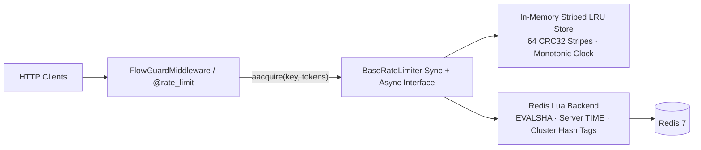

# FlowGuard

[](https://github.com/ShivanshHingve2804/FlowGuard/actions/workflows/ci.yml)
[](https://www.python.org/)
[](https://fastapi.tiangolo.com/)
[](https://redis.io/)
[](LICENSE)

**Thread-safe and Redis-distributed rate limiting for Python and FastAPI — four algorithms, sync/async APIs, atomic Lua scripts, pure ASGI middleware, and an interactive visualization dashboard.**

FlowGuard enforces deterministic rate limits both in-process (via 64-stripe `RLock` sharding + bounded LRU eviction) and across distributed API replicas (via single-RTT Redis Lua scripts using server `TIME` and Cluster-safe `{key}` hash tags).

---

## Verified Highlights

- **Four Algorithms, Dual Backends ([`src/flowguard/algorithms/`](src/flowguard/algorithms/)):** Implements `TokenBucketLimiter`, metered `LeakyBucketLimiter`, exact `SlidingWindowLogLimiter`, and `SlidingWindowCounterLimiter` — plus distributed `Redis*Limiter` counterparts with `acquire`/`aacquire` and `reset`/`areset`.
- **Atomic Redis Lua Execution ([`src/flowguard/algorithms/redis_backend.py`](src/flowguard/algorithms/redis_backend.py)):** Executes all state reads, time advancement, mutations, and TTL expirations atomically via `EVALSHA` inside Redis 7 (`NOSCRIPT`-resilient), eliminating TOCTOU race leaks across processes (proven across concurrent dual-client stress tests). Configurable `fail_open` vs fail-closed resilience.
- **64-Stripe Lock Sharding & Bounded Memory ([`src/flowguard/algorithms/base.py`](src/flowguard/algorithms/base.py)):** Shards keys via `CRC32` across 64 independent `RLock` stripes with per-stripe LRU eviction (`max_keys`), using `time.monotonic()` to stay immune to wall-clock NTP jumps. Measured at **28.7k–39.7k QPS** (`p50 <= 0.0058 ms`) under 50-thread multi-key load.
- **Pure ASGI Middleware & Per-Route Decorator ([`src/flowguard/middleware/`](src/flowguard/middleware/)):** Zero-buffering `FlowGuardMiddleware` (`__call__(scope, receive, send)`) and `@rate_limit` decorator emit standard `X-RateLimit-Limit`, `X-RateLimit-Remaining`, `X-RateLimit-Reset`, and `Retry-After` headers on allowed and `429` responses, with opt-in `trust_proxy_headers` spoof protection.
- **32 Automated Tests, `89.58%` Coverage & CI ([`.github/workflows/ci.yml`](.github/workflows/ci.yml)):** Runs `ruff`, `mypy`, `pytest` against a live Redis 7 container across Python `3.11`/`3.12`, and a Docker `container-build` check.

---

## Architecture



| Decision | Rationale |
|---|---|
| **Pure ASGI `__call__` instead of `BaseHTTPMiddleware`** | Avoids Starlette response/body stream buffering overhead while injecting `X-RateLimit-*` headers cleanly in `http.response.start`. |
| **Redis Lua (`redis.call('TIME')`) + `{key}` hash tags** | Prevents multi-node clock skew and cross-process TOCTOU races in one network round trip, while remaining Redis Cluster slot-safe. |
| **64 `CRC32` stripe locks + per-stripe LRU** | Eliminates global mutex contention across unrelated tenants/IPs and prevents OOM growth under high-cardinality key floods. |
| **`trust_proxy_headers=False` by default** | Prevents clients from bypassing IP limits via spoofed `X-Forwarded-For` headers unless explicitly behind a trusted proxy. |

---

## Quick Start

### 1. Install & Run Locally

```bash
pip install -e ".[dev]"
```

```python
from fastapi import FastAPI, Request
from flowguard import (
    FlowGuardMiddleware,
    RedisTokenBucketLimiter,
    TokenBucketLimiter,
    rate_limit,
)

app = FastAPI()

# In-memory striped limiter (single process) or RedisTokenBucketLimiter (multi-replica)
limiter = TokenBucketLimiter(capacity=100, refill_rate=10.0)
app.add_middleware(FlowGuardMiddleware, limiter=limiter, exclude_paths={"/health"})


@app.get("/health")
def health():
    return {"status": "healthy"}


@app.get("/strict")
@rate_limit(limit=5, window=60.0, algorithm="sliding_window_log")
async def strict_endpoint(request: Request):
    return {"ok": True}
```

### 2. Boot Interactive Dashboard + Redis with Docker Compose

```bash
docker compose up -d --build
# Open http://localhost:8888 for real-time gauges, timeline & multi-thread benchmarks
```

### 3. Run Checks, Tests & Benchmarks

```bash
# Lint, typecheck, and full test suite (requires Redis at REDIS_URL)
make lint
make test

# Multi-algorithm benchmark (in-memory & live Redis)
python -m flowguard.cli.benchmark --algorithm all --requests 20000 --concurrency 50 --keys 16
python -m flowguard.cli.benchmark --algorithm all --requests 2000 --concurrency 20 --keys 16 --redis-url redis://localhost:6379/0
```

---

## Algorithm Comparison

| Algorithm | Memory | Burst Handling | Precision | Use Case |
|---|---|---|---|---|
| **Token Bucket** | `O(1)` / key | Bursts up to `capacity` | Continuous refill | General API rate limiting |
| **Leaky Bucket** | `O(1)` / key | Metered burst up to `capacity`, fixed drain | Continuous drain | Traffic shaping & steady pacing |
| **Sliding Window Log** | `O(limit)` / key | Hard window cap | Exact per-request | Strict login/auth protection |
| **Sliding Window Counter** | `O(1)` / key | Weighted window rollover | Smooth approximation | High-scale distributed limits |

---

## Further Reading

- **[`docs/ARCHITECTURE.md`](docs/ARCHITECTURE.md)** — Striped locking internals, Lua atomicity, ASGI header flow, and trade-offs
- **[`docs/API.md`](docs/API.md)** — Limiter constructors, Redis config, middleware options, `@rate_limit`, and dashboard APIs
- **[`docs/BENCHMARKS.md`](docs/BENCHMARKS.md)** — Measured 50-thread in-memory (`39.7k QPS`) and 20-thread Redis 7 Lua (`4.29k QPS`) results
