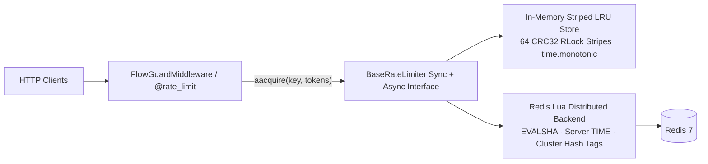

# FlowGuard Architecture

## System Overview

---

## Core Design Principles

### 1. Striped Locking & Bounded LRU State (`src/flowguard/algorithms/base.py`)
- In-memory limiters shard keys across **64 independent `RLock` stripes** via deterministic `zlib.crc32(key) % 64`. Requests for different keys never contend on a global lock.
- Each stripe holds its own `OrderedDict` with configurable `max_keys` (default `10,000`). Every `acquire` moves the key to MRU and evicts the oldest stripe entry once capacity is exceeded, bounding memory under high-cardinality traffic.
- All in-memory clocks default to `time.monotonic()` (plus an injectable `clock` for deterministic tests) and clamp elapsed deltas at `0.0` to prevent NTP/wall-clock backward jumps from corrupting token balances.

### 2. Atomic Distributed Redis Lua Execution (`src/flowguard/algorithms/redis_backend.py`)
All four algorithms execute inside **single-RTT Lua scripts** registered via `EVALSHA` (with automatic `NOSCRIPT` fallback):
- **Server-side `redis.call('TIME')`:** Eliminates clock skew across distributed API containers.
- **Redis Cluster hash-tag keys (`{key}`):** Ensures multi-key scripts (e.g., `SlidingWindowLog` ZSET + monotonic sequence key) map to the same hash slot.
- **Dual Sync + Async Clients:** `acquire`/`reset` use `redis.Redis`; `aacquire`/`areset` use `redis.asyncio.Redis` directly for non-blocking ASGI throughput.
- **Explicit Failure Policy (`fail_open`):** Defaults to fail-closed (`fail_open=False`); when `fail_open=True`, Redis connection errors are logged and allowed through rather than blocking traffic.

### 3. Pure ASGI Middleware & Route Decorator
- **`FlowGuardMiddleware` (`src/flowguard/middleware/fastapi_middleware.py`)** implements raw ASGI `__call__(scope, receive, send)` instead of Starlette `BaseHTTPMiddleware`, avoiding request-body buffering overhead and preserving streaming responses.
- Attaches `X-RateLimit-Limit`, `X-RateLimit-Remaining`, and `X-RateLimit-Reset` on **both allowed and `429` responses**, using `math.ceil` for `Retry-After` and safe `None` / header omission when `retry_after == inf` (zero refill/leak rate).
- **Proxy Spoofing Protection:** `trust_proxy_headers` defaults to `False` so spoofed `X-Forwarded-For` / `X-Real-IP` headers cannot bypass IP-based limits unless explicitly enabled behind a trusted reverse proxy.
- **`@rate_limit` (`src/flowguard/middleware/decorator.py`)** binds an isolated per-route limiter (`scope = module.qualname`) supporting both `async def` and `def` FastAPI endpoints or standalone Python functions.

---

## Algorithm Trade-offs

| Algorithm | Backing Structure | Burst Behavior | Precision | Best Fit |
|---|---|---|---|---|
| **Token Bucket** | Token counter + timestamp (`float`) | Allows bursts up to `capacity`, steady refill | Exact continuous refill | Public REST APIs needing burst tolerance |
| **Leaky Bucket** | Water level + timestamp (`float`) | Metered burst up to `capacity`, constant drain | Exact continuous drain | Downstream traffic shaping & steady pacing |
| **Sliding Window Log** | Timestamped entries (`deque` / Redis `ZSET`) | Hard cap within rolling `[t - W, t]` | Exact per-request | Strict security/auth limits (`O(limit)` memory) |
| **Sliding Window Counter** | 2-bucket integer window counter (`Hash`) | Weighted blend across current & previous windows | Smooth approximation (`O(1)` memory) | High-cardinality distributed rate limiting |
